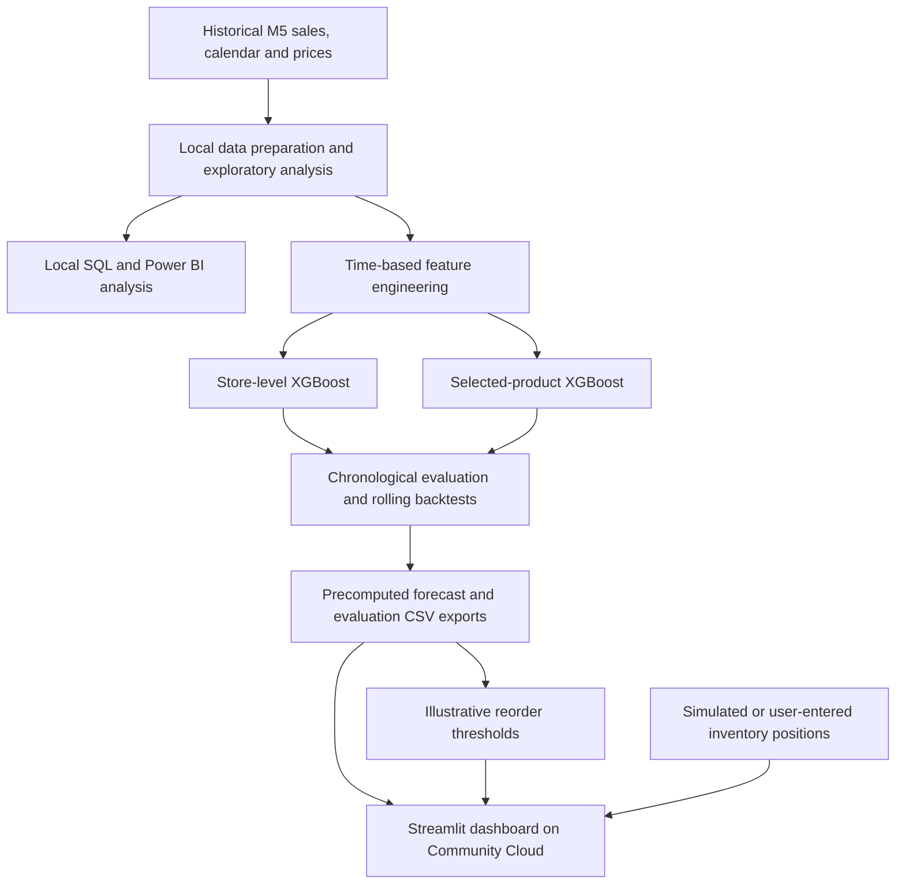

# Retail Demand Intelligence Platform

**A retail analytics and demand-forecasting portfolio project combining historical sales analysis, machine learning, and inventory decision support.**

[**Live Streamlit dashboard**](https://retail-demand-intelligence-scbt7jcazpccwnp9mxmqpl.streamlit.app/) · [**Portfolio case study**](PORTFOLIO_CASE_STUDY.md) · [**Original M5 dataset**](https://www.kaggle.com/competitions/m5-forecasting-accuracy/data)

> **Historical demonstration, not live operations.** The app forecasts the historical M5 `CA_1` store from **April 25–May 22, 2016**. Inventory-on-hand figures are **simulated**, and the deployed app serves precomputed model outputs rather than retraining models or querying a production database.

## At a glance

| Metric | Result | Interpretation |
|---|---:|---|
| Forecast horizon | **28 days** | 28 days after the last observed historical date |
| Forecasted store units | **127,421** | Sum of the 28-day `CA_1` forecast, not observed sales |
| Product coverage | **20 products** | Selected product-level forecasting subset |
| Store XGBoost backtest WAPE | **7.70%** | Pooled error over four rolling-origin validation folds |
| Product XGBoost backtest WAPE | **38.95%** | Pooled error over four rolling-origin validation folds |

## The problem

Retail teams need to anticipate demand before making replenishment decisions. Store-level trends help with capacity planning, while item-level demand helps identify potential stock gaps. Product-level sales can be intermittent and much harder to predict than aggregated store demand.

This project explores three questions:

1. **How many units might one store sell over the next 28 days?**
2. **How does expected demand differ across selected products?**
3. **How can forecasts inform a transparent, hypothetical inventory-risk scenario?**

## Live dashboard features

The deployed Streamlit app has **five tabs**:

| Tab | What it shows |
|---|---|
| **Executive Overview** | 28-day store demand, coverage, validation metrics, forecast charts, simulated stock-risk summary |
| **Store Forecast** | Daily and weekly store-demand estimates for the historical 28-day horizon |
| **Product Intelligence** | Per-product 7-, 14-, and 28-day forecast summaries and a product selector |
| **Inventory Risk** | Simulated risk classifications plus an interactive stock-and-lead-time simulator |
| **Model Performance** | XGBoost versus seasonal-naïve comparison across rolling backtest folds |

The inventory simulator accepts hypothetical **on-hand stock**, **incoming units**, **backorders**, and **7/14/28-day supplier lead times**, recalculating inventory position, lead-time demand, safety stock, reorder point, and risk category. These inputs are *demonstration scenarios*, not actual Walmart inventory.

## Model evaluation

A **28-day seasonal-naïve baseline** was evaluated against XGBoost. Validation used chronological splits, including a separate final 28-day holdout and four earlier rolling-origin backtest folds. WAPE is reported as an **error rate**, not a claim of classification accuracy or guaranteed future performance.

### Rolling-origin backtesting — pooled across four folds

| Forecast level | Seasonal naïve WAPE | XGBoost WAPE | Relative WAPE reduction |
|---|---:|---:|---:|
| `CA_1` store | 11.18% | **7.70%** | **~31.1%** |
| Selected 20 products | 45.94% | **38.95%** | **~15.2%** |

### Final chronological 28-day holdout

| Forecast level | Seasonal naïve WAPE | XGBoost WAPE |
|---|---:|---:|
| `CA_1` store | 10.05% | **4.13%** |
| Selected 20 products | 40.50% | **31.14%** |

**WAPE = 100 × sum(abs(actual − forecast)) / sum(actual).** The pooled backtest scores are the principal figures shown in the application. Product forecasts have materially higher error than the aggregate-store forecast; their results should not be interpreted as interchangeable. The 20-product subset is not intended to sum to the full-store forecast, and the two models are not reconciled.

## How it works



**Development workflow:** Python/Jupyter, Pandas, MySQL, Power BI, scikit-learn/XGBoost and local model artifacts. Feature engineering used calendar information, day-of-week/weekend signals, available event/SNAP information, and lag/rolling demand features. The product model also uses product identifiers. Chronological validation and lag construction were designed to avoid using the target period's sales as input.

**Deployed workflow:** Streamlit + Pandas + Altair reading small, precomputed CSV artifacts. **The deployment repository is intentionally a lightweight application package**, not the complete SQL notebooks, Power BI report, training pipelines or raw M5 CSV files.

## Inventory logic — simulation, not live stock

For a chosen product and lead time `L`:

```text
Inventory position = stock on hand + units on order − backordered units
Expected lead-time demand = sum of forecast units during lead time
Illustrative safety stock = ceil(1.645 × std(last 90 days' daily units) × sqrt(L))
Reorder point = ceil(expected lead-time demand + safety stock)
```

The app groups scenarios into **Critical** (inventory position below expected demand), **Reorder Review** (demand covered but not the modeled buffer), and **Adequate** (above the modeled reorder threshold). The safety-stock formula assumes approximately independent daily variation and fixed lead times. The `1.645` factor is illustrative; **no 95% service-level guarantee has been calibrated or established**. This is not a purchase-order recommendation.

## Repository structure

```text
.
├── app/
│   └── app.py
├── .streamlit/
│   └── config.toml
├── data/
│   └── processed/
│       ├── ca1_28day_forecast.csv
│       └── ca1_top20_28day_forecasts.csv
├── reports/
│   ├── ca1_rolling_backtest_results.csv
│   ├── ca1_top20_rolling_backtest.csv
│   ├── ca1_top20_inventory_demand_plan.csv
│   ├── ca1_top20_inventory_reorder_points.csv
│   └── ca1_top20_inventory_risk_simulated.csv
├── .gitignore
├── requirements.txt
├── README.md
├── PORTFOLIO_CASE_STUDY.md
└── RESUME_PROJECT.md
```

## Run locally

Requires **Python 3.11** (the development version). From the repository root:

```bash
python -m venv .venv
# Windows PowerShell: .venv\Scripts\Activate.ps1
# macOS/Linux: source .venv/bin/activate
pip install -r requirements.txt
streamlit run app/app.py
```

The application uses relative paths, so it should be launched from the repository root. It does not require a running MySQL server, installed XGBoost model, or original raw M5 files.

## Data source and attribution

The upstream source is the [M5 Forecasting — Accuracy dataset](https://www.kaggle.com/competitions/m5-forecasting-accuracy/data), which contains historical Walmart sales, calendar, and selling-price data. See its **competition rules and reuse terms** before redistributing source data. This repository omits the large original raw files and contains lightweight derived demonstration outputs.

The demonstrated analysis focuses on a **730-day** historical window at the **`CA_1` store** and a selected **20-product subset**. Historical results should not be presented as contemporary retail forecasts.

## Limitations and next steps

- Historical observations end in 2016; this is **not** live 2026 demand forecasting.
- Only one store and 20 products are included in the deployed forecasting showcase.
- On-hand inventory and lead times are illustrative; true operational stock and vendor lead-time data were unavailable.
- Product-level forecasts are substantially noisier than the store-level aggregate.
- A production system would require automated ingestion, retraining, forecast monitoring, uncertainty calibration, stock integration, and more robust reconciliation.
- Local SQL, Power BI and training work are documented as the broader project workflow; this repository serves the **dashboard application**, not a reproducible end-to-end training pipeline.

---

**Portfolio project:** Retail Demand Intelligence Platform · Python · Pandas · SQL/MySQL · Power BI · XGBoost · Streamlit · Altair
