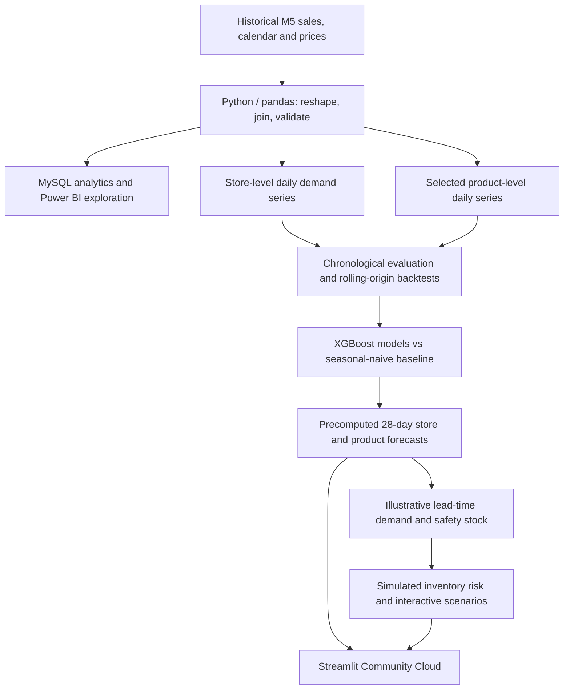
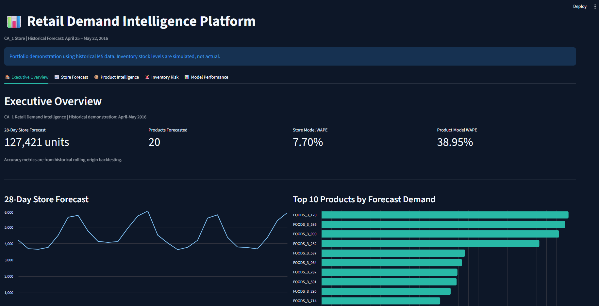

# Retail Demand Intelligence Platform

**Historical retail demand forecasting · Product analytics · Inventory decision support**

[**Launch the Streamlit demo**](https://retail-demand-intelligence-scbt7jcazpccwnp9mxmqpl.streamlit.app/) · [**Read the project case study**](docs/PROJECT_CASE_STUDY.md) · [**Portfolio and resume copy**](docs/RESUME_LINKEDIN.md)

> **Scope and transparency:** This is a portfolio demonstration using the historical M5 forecasting dataset, not a live retail system. The forecast displayed in the app covers **April 25–May 22, 2016** for store **CA_1**. Inventory quantities are **simulated**, and reorder points are illustrative—not verified purchasing recommendations. The cloud app reads **precomputed forecasts**; it does not retrain models or connect to MySQL at runtime.

## The problem

Retail teams need to anticipate changing demand across the store and individual products, review model reliability, and identify items that may need replenishment. This project connects historical sales analysis to time-series forecasting and a transparent inventory-risk simulator in a shareable Streamlit dashboard.

## At a glance

| Measure | Result | Interpretation |
|---|---:|---|
| Store forecast horizon | 28 days | Historical out-of-sample demonstration window, Apr 25–May 22, 2016 |
| Store forecast volume | **127,421 units** | Sum of the displayed 28 daily store predictions |
| Product forecast coverage | **20 items** | Selected items, not the full store assortment |
| Store-level XGBoost WAPE | **7.70%** | Pooled across 4 rolling-origin backtest folds |
| Product-level XGBoost WAPE | **38.95%** | Pooled across 4 rolling-origin backtest folds |
| Inventory analysis | 7-, 14-, 28-day lead times | Scenario-based reorder thresholds and stock-risk classification |

### Model results: same evaluation protocol, like-for-like baselines

| Forecast level | Seasonal-naïve WAPE | XGBoost WAPE | Relative reduction in WAPE |
|---|---:|---:|---:|
| **Store total** | 11.18% | **7.70%** | ~31.1% |
| **20 selected products** | 45.94% | **38.95%** | ~15.2% |

Values above are **pooled rolling-origin backtesting metrics**, not guaranteed future accuracy. WAPE = `sum(abs(actual − forecast)) / sum(actual) × 100`. Lower is better. The final 28-day held-out evaluation was a separate exercise: **4.13% store WAPE** and **31.14% product WAPE** for XGBoost. These two evaluation protocols should not be conflated.

## What you can explore

1. **Executive Overview:** projected 28-day store demand, 20-product coverage, model backtest metrics, leading products, and simulated risk counts.
2. **Store Forecast:** daily demand pattern and weekly forecast summary.
3. **Product Intelligence:** select one of the 20 items to review its forecast and 7-/14-/28-day demand totals.
4. **Inventory Risk:** inspect **simulated** Critical, Reorder Review, and Adequate classifications; change hypothetical stock on hand, incoming stock, backorders, and lead time in an interactive simulator.
5. **Model Performance:** compare XGBoost and the seasonal-naïve benchmark across historical backtest folds.

## Technical approach



**Data processing:** M5 `sales_train_validation.csv`, `calendar.csv`, and `sell_prices.csv`; sales transformed into product-day observations, enriched with date/event and relevant pricing information for exploratory analysis. The forecasting work used **730 consecutive days** of CA_1 store history and focused the product model on 20 items.

**Feature engineering:** calendar and weekly patterns, holidays, California SNAP flag, 28-/35-/42-/56-day demand lags, and historical rolling features. Forecasting features were built from information available before each prediction to avoid forward-looking target leakage.

**Models and evaluation:** store-level XGBoost; one-hot-encoded global product-level XGBoost; 28-day seasonal-naïve benchmark; chronological held-out period plus **four rolling-origin folds** for robustness. The product ranking used pre-forecast sales history at each evaluation fold.

**Inventory rules (illustrative):**

- `inventory_position = stock_on_hand + units_on_order - backordered_units`
- `reorder_point = ceil(expected_lead_time_demand + safety_stock)`
- `safety_stock = ceil(1.645 × historical_daily_std × sqrt(lead_time_days))`
- **Critical:** inventory position below expected lead-time demand.
- **Reorder Review:** demand covered but inventory position at or below the reorder point.
- **Adequate:** inventory position above the reorder point.

The safety-stock formula uses simplifying distribution and lead-time assumptions; it **does not establish a calibrated 95% service-level guarantee**. No real on-hand inventory or supplier-lead-time feed is connected. Store totals and the selected 20-product forecasts are modeled separately and are **not reconciled**.

## Technology

**Python · pandas · NumPy · XGBoost · scikit-learn · MySQL 8 · Power BI · Streamlit · Altair · Git/GitHub · Streamlit Community Cloud**

The **public deployment repository** is intentionally smaller than the full local analytics/training workspace: it contains the Streamlit app, selected precomputed CSVs, configuration, and documentation. SQL, Power BI, and model-training work were conducted in the development workflow; those assets are **not bundled** with this deployment package.

## Repository layout

```text
.
├── .streamlit/
│   └── config.toml
├── app/
│   └── app.py
├── data/
│   └── processed/
│       ├── ca1_28day_forecast.csv
│       └── ca1_top20_28day_forecasts.csv
├── reports/
│   ├── ca1_rolling_backtest_results.csv
│   ├── ca1_top20_rolling_backtest.csv
│   ├── ca1_top20_inventory_demand_plan.csv
│   ├── ca1_top20_inventory_reorder_points.csv
│   └── ca1_top20_inventory_risk_simulated.csv
├── docs/
│   ├── PROJECT_CASE_STUDY.md
│   └── RESUME_LINKEDIN.md
├── .gitignore
├── requirements.txt
└── README.md
```

## Run locally

Requires **Python 3.11** (recommended) and the committed precomputed CSV files.

```bash
python -m venv .venv
# Activate the virtual environment for your OS.
python -m pip install -r requirements.txt
python -m streamlit run app/app.py
```

The cloud version uses `app/app.py` on branch `main` and the dependencies declared in `requirements.txt`. **No credentials or database connection are needed to view this app.**

## Key findings

- Aggregated store demand was more predictable than individual SKU demand; backtest XGBoost WAPE was **7.70% at store level** versus **38.95% across selected products**.
- XGBoost outperformed the 28-day seasonal-naïve benchmark in **all four rolling backtest folds** at both levels.
- Product forecasts support scenario-based replenishment exploration, but model error, assumed lead times, and simulated stock require caution before any operational use.

## Limitations and next steps

- **Historical-only:** data and forecasts refer to 2016; the dashboard is not a real-time forecast.
- **No true stock data:** the risk simulator uses demonstration quantities, not observed warehouse inventory.
- **Subset scope:** the product forecasts cover only 20 selected CA_1 items, while the store forecast covers store-wide demand.
- **No trained-model inference in the app:** forecasts were generated offline and exported to CSV.
- **Not an operational inventory optimizer:** costs, minimum order quantities, supplier variability, service-level calibration, and capacity constraints are not modeled.

Potential extensions: ingest more recent retail data, refresh forecasts automatically, reconcile store and product hierarchies, calibrate prediction intervals and safety stock, incorporate real supplier lead times and inventory, and measure actual business outcomes.

## Data source and attribution

Source dataset: **M5 Forecasting – Accuracy**, a historical Walmart sales forecasting challenge. See the [Kaggle competition and dataset information](https://www.kaggle.com/competitions/m5-forecasting-accuracy). The raw competition datasets are not distributed in this lightweight repository; consult the source's access and redistribution terms if you intend to publish additional data.

## Dashboard Preview



Explore the interactive dashboard using the live
Streamlit demo linked above.

*Historical M5 forecasting data; inventory
quantities are simulated.*

## Project documentation

- [Full project case study](docs/PROJECT_CASE_STUDY.md)
- [Resume and LinkedIn descriptions](docs/RESUME_LINKEDIN.md)

---

**Project type:** independent portfolio project | **Deployment:** Streamlit Community Cloud | **Data period:** historical M5 dataset (forecast window: 2016)

## Dashboard Preview


